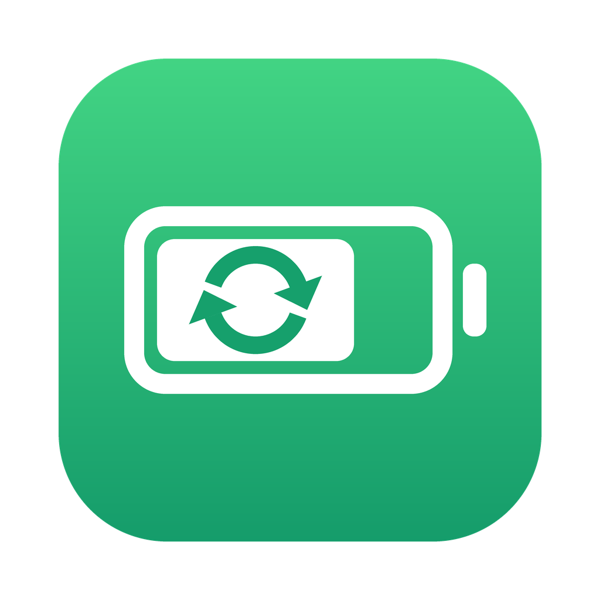

# 电池循环（BatteryCycle）



让 Mac 插着电也能在 10%–75% 之间循环：
- 电量 ≥ 75%：停止充电，断开充电器供电，由电池给电脑供电
- 电量 ≤ 10%：恢复充电器供电并开始充电，充到 75%
- 然后重复

循环开启且接着电源时 Mac 不会自动睡眠（屏幕照常关闭）；合盖仍会正常睡眠。睡眠期间暂停循环充电，接着电源时由适配器供电，完全唤醒后继续循环。夜间后台维护的短暂唤醒不会重新启动循环充电，避免睡眠中越过上限。拔掉电源或暂停循环后恢复系统默认的睡眠设置。

打开「保持屏幕常亮」开关（默认关闭）后，App 运行期间阻止屏幕因无操作而熄灭，不论是否接着电源；退出 App 后恢复。系统的自动锁屏会随之失效，所以改由 App 在无操作一段时间后锁屏（面板里可调 1–10 分钟，默认 10 分钟），放视频等其他程序要求常亮时不锁，锁屏界面保持常亮；手动锁屏、合盖不受影响。

打开「屏幕亮度降到最低」后，App 会保存 MacBook 内置屏幕的亮度和自动亮度设置，暂停系统自动亮度，再将亮度设为系统最低值。开启期间持续保持最低亮度；**直接按屏幕亮度加减键即可退出模式并正常调节**，不会被重新压回最低，也不会跳回开启前的亮度。按键处理后恢复原自动亮度设置，系统随后可正常自动调节。单独关闭开关或正常退出 App，仍会恢复开启前的设置；未被其他程序占用时，也可用恢复快捷键 **Control + Option + Command + B**。此功能与「保持屏幕常亮」独立，不影响外接显示器，也不主动改变睡眠或锁屏行为。最低亮度可能使屏幕接近全黑。

首次使用若提示授权，点击「允许亮度键调节」，在 macOS「隐私与安全性 → 输入监控」中允许 BatteryCycle，并按系统提示重新打开 App。程序只处理屏幕亮度加减功能键，不记录普通按键；监听不会拦截或重放原按键。未获得权限或监听不可用时不会调暗屏幕，以确保能直接用亮度键退出。自动亮度变化本身不会被当作按键操作，也不会解除锁定。

同时打开多个副本时，只有一个副本能控制屏幕亮度；其他副本会提示退出重复应用后重试，避免相互覆盖恢复设置。持有控制权的副本退出或崩溃后，其他副本才能接管。

重新启动 App 不会自动开启最低亮度模式；若上次异常退出留下恢复记录，会先尝试恢复原设置。恢复失败会显示「重试恢复屏幕设置」，恢复记录保留到成功为止。强制退出或崩溃后不能立即自动恢复。亮度控制依赖 macOS 私有接口；不支持或无法确认自动亮度已暂停时不会显示开启成功。

打开「管理外接显示器」开关（默认关闭）后，面板会按名称列出外接显示器，每台一个开关：关掉就断开该显示器（效果同拔线，系统不再输出画面，窗口挪到其他屏幕），打开即恢复；至少保留一块屏幕在显示。断开只在本次登录期间有效，注销、重启后自动恢复；断开状态下拔掉的显示器会自动从列表消失，插回来时自动恢复显示；关闭「管理外接显示器」也会恢复所有被断开的显示器（已拔掉的在插回来时恢复）。

「高级功能」默认锁定，点击后请求 macOS 管理员密码验证，验证通过后在原下拉框内切换到二级页，只显示「禁止 HDMI 显示输出」和「禁止 USB-C / 雷雳显示输出」两个独立开关。点击返回、关闭下拉框、锁屏或切换用户后重新锁定，已开启的输出限制继续运行；已关闭菜单的验证结果不会重新打开菜单或解锁。App 不读取或保存密码；授权规则要求管理员、密码验证且不共享或缓存凭据，系统不支持该规则时保持锁定。

HDMI 开关针对 Mac 机身 HDMI 接口；USB-C / 雷雳开关针对这些接口承载的显示输出，包括经转接器、扩展坞连接的 HDMI 显示器，不关闭 USB 数据或供电。更换显示器、重新插拔或唤醒后会重新检查并继续执行；没有连接显示器时也保留开关设置。至少保留一块可用屏幕；接口无法可靠确认时不尝试关闭，并在解锁后的二级页中提示。普通的逐台显示器开关不能绕过高级功能中已开启的限制。

关闭某个高级开关时，只恢复该功能改动的显示器，原本手动关闭的保持关闭。正常退出 App 不会解除仍开启的限制：被限制的显示器保持停用，直到注销或重启（系统本身会恢复），重新打开 App 后继续执行保存的限制；退出时只恢复已关闭限制但尚未恢复完成的显示器。管理员验证只保护开关本身：限制由当前用户的 App 执行，强制结束进程或删除恢复记录文件后，重新插拔的显示器不再受限，需要防范普通用户时请使用 MDM 等系统级管控。该能力依赖 macOS 私有显示接口与驱动属性，属于检测到显示器后停用，**不保证插入或唤醒时零闪屏，也不等同于硬件层面封禁端口**。密码专用授权字段同样依赖系统实现，需要在目标 macOS 上验收。

停用后即使系统暂时不再提供显示器标识，仍会保留本次登录期间的恢复目标；关闭限制时主动恢复，并等到系统确认画面输出已启用才清除恢复记录。恢复未完成会在高级功能二级页中提示，不把列表消失或接口返回成功当作已经恢复。确认已拔线的记录等待重新接入；登录会话已变化或显示器标识被其他设备占用时不会盲用旧编号。

需要出门时可以点「立即充满电」，确认后临时充到 100%（合盖睡眠期间也允许充电），充满后自动回到循环，不用手动关掉再打开。

菜单栏常驻图标显示当前电量，点击后可以查看电池健康度和充电循环次数、开关循环、调整上下限。

电池健康信息下方显示内置插口的连接状态：MagSafe 在最前，USB-C 按物理位置显示（左上、左下、右侧），HDMI 在最后。只列出系统能识别的插口；无法读取状态时显示「未知」，不把它当作未连接。「已连接」仅代表插口连接，不代表正在供电或给电池充电。

插口状态在收到系统事件时刷新，并每秒检查一次兜底；打开面板、唤醒时立即请求刷新。系统驱动上报和调度可能带来额外延迟，1 秒是检查间隔而非端到端延迟保证。位置与状态依赖 macOS 驱动属性，缺少位置时使用端口编号，不猜左右。

适用于 Apple Silicon（M 系列）Mac，需要 macOS 13 或更高版本。

## 下载安装

1. 在 [Releases](../../releases) 页面下载 `BatteryCycle.zip`（或在 Actions 每次构建的 Artifacts 里下载）
2. 解压，把 `BatteryCycle.app` 拖进「应用程序」
3. App 没有经过苹果公证，第一次打开前在终端运行：
   ```sh
   xattr -cr /Applications/BatteryCycle.app
   ```
4. 打开 App，点击菜单栏的电池图标 →「安装后台服务」，输入一次管理员密码
5. 在面板里打开「登录时自动打开」

使用前请先：
- 在 系统设置 → 电池 → 电池健康 中关闭「优化电池充电」
- 退出 AlDente 等其他电池管理软件

后台服务停止、无法控制充电、「立即充满」完成或作废时会发系统通知；到达上下限的通知默认关闭，可在面板里打开。出问题时可以在 ⋯ 菜单里「复制诊断信息」。

更新 App 后，如果后台服务也有改动，面板会提示「更新后台服务」，点一下即可。

卸载：面板右下角 ⋯ →「卸载后台服务」，然后删除 App。

## 从源码构建

```sh
xcode-select --install
make            # 生成 app/build/BatteryCycle.app
make install    # 复制到「应用程序」并打开
```

端口采集和刷新检查（只需 Command Line Tools）：

```sh
sh app/test-ports.sh
BATTERYCYCLE_TEST_LIVE_PORTS=1 sh app/test-ports.sh # 另输出本机只读快照及采集耗时
sh app/test-brightness.sh # 模拟亮度控制和恢复检查，不修改实际亮度
sh app/test-display-output.sh # 接口分类、独立限制、恢复和管理员门控；不实际改屏幕或请求密码
sh app/test-menu-navigation.sh # 同框二级页的验证、返回和关闭；不请求真实密码
swift test --package-path app # 安装完整 Xcode（含 XCTest）时可运行完整单元测试
```

推送到 `main` 会自动构建；推送 `v*` 标签（如 `git tag v1.0.1 && git push --tags`）会发布 Release。

## 组成

| 部分 | 说明 |
|---|---|
| `app/` | SwiftUI 菜单栏 App，负责显示和设置 |
| `main.c`, `smc.c` | 后台服务 batteryd，以 root 运行，通过 SMC 控制充电 |
| `install.sh`, `uninstall.sh` | 打包在 App 内，由「安装 / 卸载后台服务」调用 |
| `scripts/make_icon.py` | 生成 App 图标 |

运行时文件：

| 路径 | 说明 |
|---|---|
| `/Library/Application Support/batteryd/config` | 设置（App 写入，服务读取） |
| `/Library/Application Support/batteryd/fullcharge` | 存在时临时充到 100%（App 创建，服务充满后删除；12 小时内没充满自动作废） |
| `/var/run/batteryd.json` | 服务状态（服务写入，App 读取） |
| `/var/db/batteryd.state` | 当前处于充电还是放电阶段，重启后继续 |
| `/var/db/batteryd.reached` | 上次充到上限的时间和当时的上限值 |
| `/var/log/batteryd.log` | 服务日志 |
