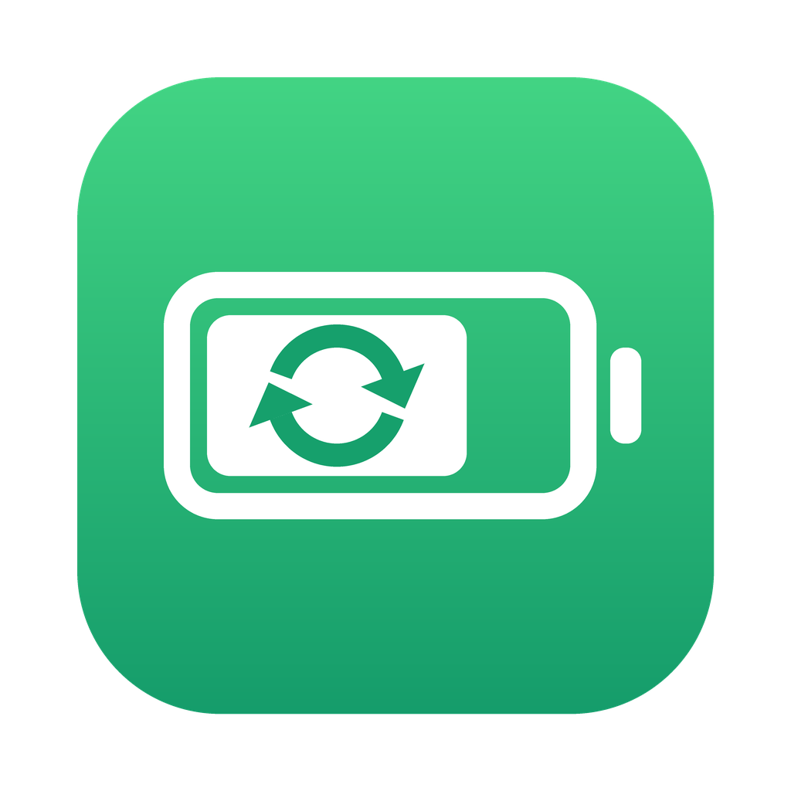

# 电池循环（BatteryCycle）



让 Mac 插着电也能在 10%–75% 之间循环：
- 电量 ≥ 75%：停止充电，断开充电器供电，由电池给电脑供电
- 电量 ≤ 10%：恢复充电器供电并开始充电，充到 75%
- 然后重复

循环开启且接着电源时 Mac 不会自动睡眠（屏幕照常关闭），否则睡眠中没法在上下限处切换；合盖仍会正常睡眠。拔掉电源或暂停循环后恢复系统默认的睡眠设置。

「保持屏幕常亮」开关（默认打开）在 App 运行期间阻止屏幕因无操作而熄灭，不论是否接着电源；手动锁屏、合盖不受影响，退出 App 后恢复。

需要出门时可以点「立即充满电」，确认后临时充到 100%，充满后自动回到循环，不用手动关掉再打开。

菜单栏常驻图标显示当前电量，点击后可以查看电池健康度和充电循环次数、开关循环、调整上下限。

适用于 Apple Silicon（M 系列）Mac，需要 macOS 13 或更高版本。

## 下载安装

1. 在 [Releases](../../releases) 页面下载 `BatteryCycle.zip`（或在 Actions 每次构建的 Artifacts 里下载）
2. 解压，把 `BatteryCycle.app` 拖进「应用程序」
3. App 没有经过苹果公证，第一次打开前在终端运行：
   ```sh
   xattr -cr /Applications/BatteryCycle.app
   ```
4. 打开 App，点击菜单栏的电池图标 →「安装后台服务」，输入一次管理员密码
5. 在面板里打开「登录时自动打开」

使用前请先：
- 在 系统设置 → 电池 → 电池健康 中关闭「优化电池充电」
- 退出 AlDente 等其他电池管理软件

后台服务停止、无法控制充电、「立即充满」完成或作废时会发系统通知；到达上下限的通知默认关闭，可在面板里打开。出问题时可以在 ⋯ 菜单里「复制诊断信息」。

更新 App 后，如果后台服务也有改动，面板会提示「更新后台服务」，点一下即可。

卸载：面板右下角 ⋯ →「卸载后台服务」，然后删除 App。

## 从源码构建

```sh
xcode-select --install
make            # 生成 app/build/BatteryCycle.app
make install    # 复制到「应用程序」并打开
```

推送到 `main` 会自动构建；推送 `v*` 标签（如 `git tag v1.0.1 && git push --tags`）会发布 Release。

## 组成

| 部分 | 说明 |
|---|---|
| `app/` | SwiftUI 菜单栏 App，负责显示和设置 |
| `main.c`, `smc.c` | 后台服务 batteryd，以 root 运行，通过 SMC 控制充电 |
| `install.sh`, `uninstall.sh` | 打包在 App 内，由「安装 / 卸载后台服务」调用 |
| `scripts/make_icon.py` | 生成 App 图标 |

运行时文件：

| 路径 | 说明 |
|---|---|
| `/Library/Application Support/batteryd/config` | 设置（App 写入，服务读取） |
| `/Library/Application Support/batteryd/fullcharge` | 存在时临时充到 100%（App 创建，服务充满后删除；12 小时内没充满自动作废） |
| `/var/run/batteryd.json` | 服务状态（服务写入，App 读取） |
| `/var/db/batteryd.state` | 当前处于充电还是放电阶段，重启后继续 |
| `/var/db/batteryd.reached` | 上次充到上限的时间和当时的上限值 |
| `/var/log/batteryd.log` | 服务日志 |
